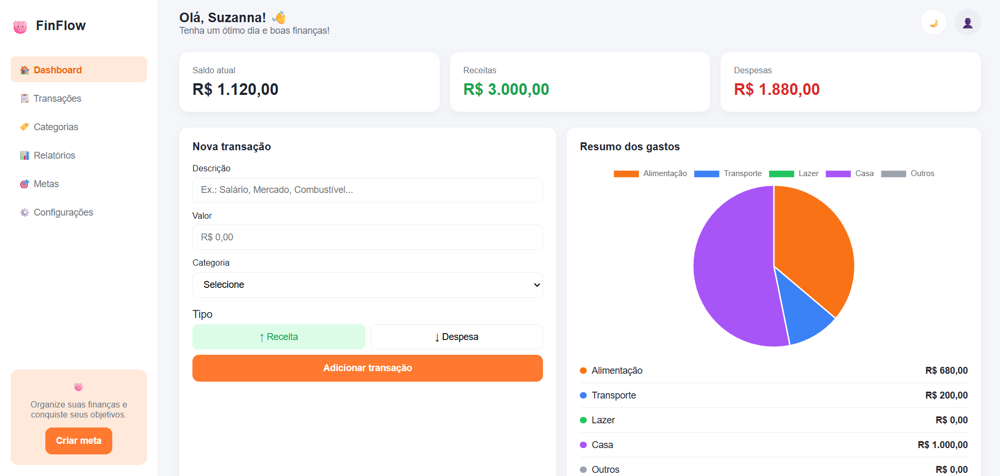
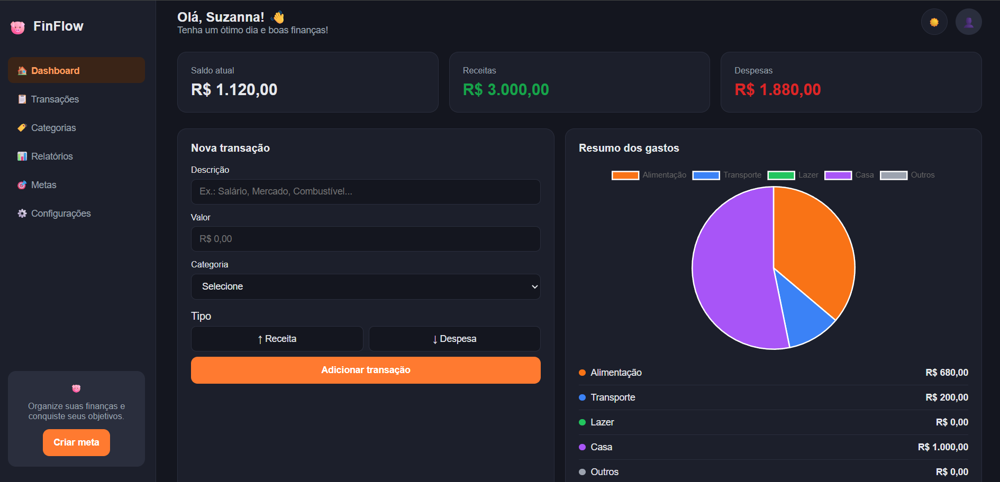
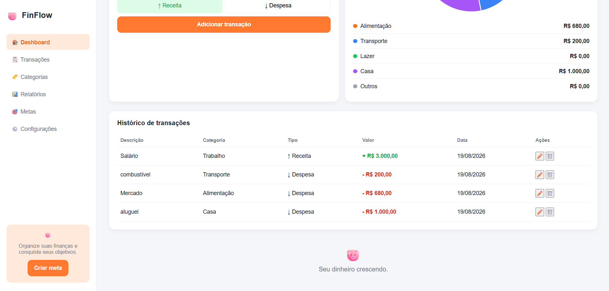

🐷 FinFlow

Dashboard financeiro para controle de receitas e despesas, desenvolvido durante meus estudos. A versão 1 é um front-end em HTML, CSS e JavaScript puro. A versão 2 adiciona uma API REST em Java (Spring Boot) com banco de dados MySQL.

✨ Funcionalidades
Front-end (v1 — concluída)
Cadastro, edição e exclusão de transações (descrição, valor, categoria e tipo)
Cálculo automático de saldo, receitas e despesas
Resumo dos gastos agrupado por categoria
Gráfico de gastos por categoria
Histórico de transações
Filtros por tipo (receitas e despesas) e por categoria, combináveis
Dados salvos no navegador com localStorage
Modo claro/escuro
Interface responsiva

Back-end (v2 — em desenvolvimento)
API REST com CRUD completo de transações (/transactions)
Filtros por tipo e por categoria via parâmetros na URL
Validações dos dados de entrada (campos obrigatórios e valor positivo)
Persistência em MySQL com Spring Data JPA / Hibernate
Arquitetura em camadas: controller, service, repository e model

🛠️ Tecnologias

Front-end: HTML5, CSS3, JavaScript (puro, sem frameworks), LocalStorage

Back-end: Java 25, Spring Boot 4, Spring Web, Spring Data JPA, Bean Validation, MySQL, Maven

📂 Estrutura do projeto
FinFlow/
├── css/
│   ├── responsive.css
│   ├── style.css
│   └── variables.css
├── js/
│   ├── app.js
│   ├── storage.js
│   ├── transactions.js
│   └── ui.js
├── images/
├── index.html
└── finflow-api/finflow-api/        ← API em Java
    ├── pom.xml
    └── src/main/java/com/suzannadias/finflow/
        ├── controller/             # endpoints REST
        ├── service/                # regras de negócio
        ├── repository/             # acesso ao banco
        └── model/                  # entidades (Transaction, TransactionType)
🔌 Endpoints da API
Método	Rota	Descrição
GET	/transactions	Lista transações (filtros opcionais type, category)
GET	/transactions/{id}	Busca uma transação pelo id
POST	/transactions	Cria uma transação
PUT	/transactions/{id}	Atualiza uma transação
DELETE	/transactions/{id}	Remove uma transação

Exemplo de corpo para criar uma transação:

json
{
  "description": "Mercado",
  "amount": 150.50,
  "category": "Alimentação",
  "type": "EXPENSE",
  "date": "2026-11-23"
}

Valores aceitos em type: INCOME (receita) e EXPENSE (despesa).

▶️ Como executar
Front-end (v1)
Clone este repositório.
Abra a pasta no VS Code.
Abra o index.html no navegador ou use a extensão Live Server.
Back-end (v2)

Pré-requisitos: JDK 21 ou superior e MySQL instalado.

Entre na pasta da API:
cd finflow-api/finflow-api
Crie o arquivo src/main/resources/application-local.properties com os dados do seu MySQL (esse arquivo não vai para o Git):
properties
spring.datasource.url=jdbc:mysql://localhost:3306/finflow?createDatabaseIfNotExist=true
spring.datasource.username=SEU_USUARIO
spring.datasource.password=SUA_SENHA
Rode a aplicação:
./mvnw spring-boot:run

No Windows: mvnw.cmd spring-boot:run 4. Acesse http://localhost:8080/transactions. A tabela é criada automaticamente na primeira execução.

🚧 Status e próximos passos

[x] Front-end completo com localStorage (v1)
[x] API REST com CRUD, filtros e validações
[x] Integração com MySQL
[ ] Tratamento de erros padronizado (404, mensagens de validação)
[ ] Endpoint de resumo financeiro (saldo, receitas, despesas e total por categoria)
[ ] Integrar o front-end à API (trocar localStorage por chamadas fetch)
[ ] Testes automatizados com JUnit
[ ] Autenticação de usuários
[ ] Deploy online

## 🖥️ Representação visual

### ☀️ Dashboard — modo claro

### 🌙 Dashboard — modo escuro

### 💳 Gerenciamento de transações

---

👩‍💻 **Projeto desenvolvido por Suzanna Dias**
